# Manual de Usuario
## Sistema de Control Financiero y Administrativo — Iglesia Centroamericana Nueva Vida

Este manual describe los módulos ya construidos y cómo usarlos. Los 10 módulos del plan y las 17 pantallas están completos: las 16 con mockup de referencia más Aportantes (módulo adicional no contemplado en los mockups originales, que pasa a ser la pantalla 17).

**Demo funcional:** 27 de septiembre de 2026.

> **Nota para quien continúe este documento:** el manual ya está completo en contenido y capturas — cada sección incluye capturas de pantalla reales, tomadas contra el sistema corriendo (`docs/capturas/`). Solo falta maquetar el documento según el formato de tesis de la universidad (portada, numeración de página, etc.).

## Índice

1. [Ingreso al sistema (Login)](#1-ingreso-al-sistema-login)
2. [Roles y qué puede hacer cada uno](#2-roles-y-qué-puede-hacer-cada-uno)
3. [Dashboard](#3-dashboard)
4. [Categorías](#4-categorías-solo-administrador)
5. [Aportantes](#5-aportantes-solo-administrador)
6. [Usuarios y Roles](#6-usuarios-y-roles-solo-administrador)
7. [Ingresos](#7-ingresos-administrador-y-tesorero-gestionan-supervisor-solo-consulta)
8. [Egresos](#8-egresos-mismo-esquema-de-permisos-que-ingresos)
9. [Facturas y Recibos](#9-facturas-y-recibos-mismo-esquema-de-permisos)
10. [Reportería](#10-reportería-todos-los-roles-incluido-consulta)
11. [Bitácora](#11-bitácora-administrador-y-supervisor)
12. [Anexo: Notas técnicas para quien administre el sistema](#anexo-notas-técnicas-para-quien-administre-el-sistema)

---

## 1. Ingreso al sistema (Login)

### Cómo levantar el servicio (XAMPP)

**Opción normal — Panel de control de XAMPP:**
1. Abra **XAMPP Control Panel** (`C:\xampp\xampp-control.exe`).
2. Presione **Start** en los módulos **Apache** y **MySQL**. Ambos deben quedar en verde.

**Opción manual — sin el panel de control** (por ejemplo, si el panel no abre o prefiere hacerlo desde la terminal):

1. Abra dos ventanas de línea de comandos (o dos pestañas de PowerShell) en `C:\xampp`.
2. En la primera, inicie Apache:
   ```
   C:\xampp\apache_start.bat
   ```
   o directamente:
   ```
   C:\xampp\apache\bin\httpd.exe
   ```
3. En la segunda, inicie MySQL:
   ```
   C:\xampp\mysql_start.bat
   ```
   o directamente:
   ```
   C:\xampp\mysql\bin\mysqld.exe --defaults-file=C:\xampp\mysql\bin\my.ini --standalone
   ```
4. **No cierre esas dos ventanas** mientras trabaja — cerrarlas detiene el servicio. Minimícelas en vez de cerrarlas.
5. Para detener el servicio: `C:\xampp\apache_stop.bat` y `C:\xampp\mysql_stop.bat`, o simplemente cierre las ventanas de la consola. Si un proceso queda colgado, `C:\xampp\killprocess.bat` lo fuerza a terminar.

> **Nota de puertos:** Apache escucha en el puerto **80** y el MySQL de XAMPP en el puerto **3307** (no el 3306 por defecto — así está configurado en `mysql\bin\my.ini` y en `config/database.php` de este proyecto, para no chocar con otra instancia de MySQL que pueda estar instalada como servicio de Windows en esta máquina). Si Apache no arranca, generalmente es porque otro programa (Skype, IIS, otro Apache) ya está usando el puerto 80.

Una vez ambos servicios están arriba, continúe con el login:

**URL local:** `http://localhost/sistema_iglesia/public/index.php?c=auth&a=login`

1. Ingrese su **usuario** y **contraseña**.
2. Si los datos son incorrectos, el sistema muestra un mensaje genérico ("Usuario o contraseña incorrectos") sin indicar cuál campo falló, por seguridad.
3. Después de **5 intentos fallidos consecutivos**, la cuenta se bloquea automáticamente. Debe contactar a un Administrador para desbloquearla.
4. Para salir, use **Cerrar sesión** en la esquina superior derecha (visible en todas las pantallas; en celular se muestra solo el ícono).

### Recuperación de contraseña

1. En la pantalla de login, dé clic en **"¿Olvidó su contraseña?"**.
2. Ingrese su correo registrado y dé clic en **"Enviar Enlace de Recuperación"**. El sistema siempre muestra el mismo mensaje genérico (exista o no el correo), por seguridad.
3. Si el correo existe y la cuenta está activa, se envía un enlace válido por **30 minutos** al correo.
4. Al abrir el enlace, ingrese su nueva contraseña dos veces. Debe tener mínimo 8 caracteres, una mayúscula, un número y un símbolo (`!@#$%&*`).
5. El enlace se invalida después de usarse una vez o al vencer los 30 minutos; si ya no es válido, se ofrece la opción de solicitar uno nuevo.
6. El correo recibido usa la paleta de colores del sistema (encabezado navy/teal, botón de acción, acento en amber) y se ve como una notificación profesional de la aplicación, no como un correo genérico.

> El envío de correo usa SMTP configurado en `config/mail.php` (no versionado en git por contener credenciales). Actualmente usa un correo personal temporal para pruebas/demo; deberá reemplazarse por las credenciales del hosting definitivo antes de producción.

### Usuarios de prueba disponibles

| Usuario | Contraseña | Rol |
|---|---|---|
| `admin` | `Admin1234!` | Administrador |
| `tesorero1` | `Tester123!` | Tesorero |
| `supervisor1` | `Tester123!` | Supervisor |
| `consulta1` | `Tester123!` | Consulta |

Estos usuarios se crearon con scripts temporales (`tmp_create_admin.php`, `tmp_create_test_users.php`) para poder probar el sistema. Se recomienda **cambiar sus contraseñas o eliminarlos** antes de usar el sistema con datos reales de la iglesia.


*Pantalla de inicio de sesión.*

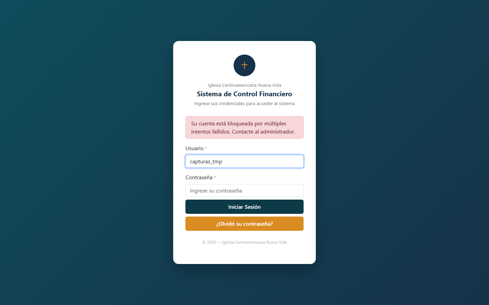
*Mensaje mostrado al intentar ingresar con la contraseña correcta en una cuenta ya bloqueada por intentos fallidos.*

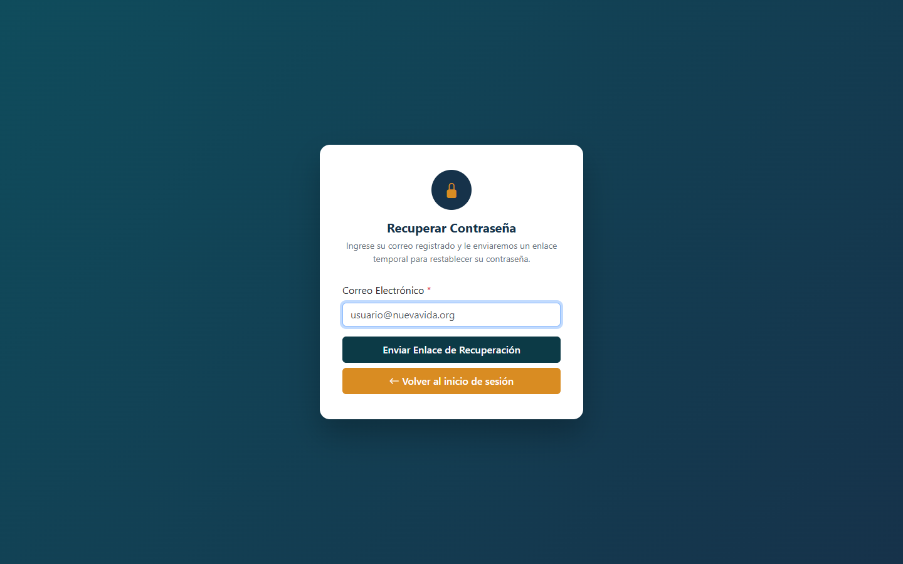
*Solicitud del enlace de recuperación.*

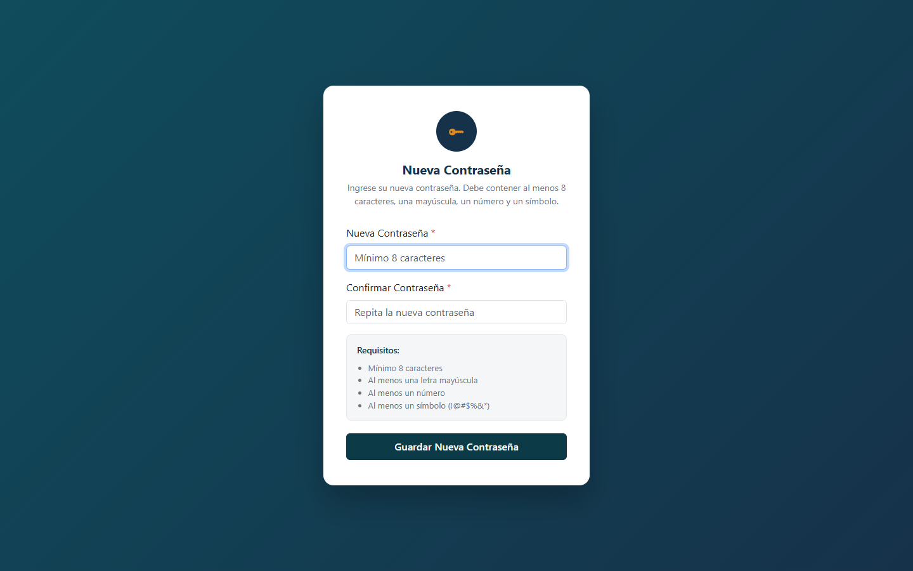
*Formulario para definir la nueva contraseña, con el listado de requisitos.*

---

## 2. Roles y qué puede hacer cada uno

| Módulo | Administrador | Tesorero | Supervisor | Consulta |
|---|:---:|:---:|:---:|:---:|
| Dashboard | Ver | Ver | Ver | Ver |
| Ingresos | Gestionar | Gestionar | Solo ver | Sin acceso |
| Egresos | Gestionar | Gestionar | Solo ver | Sin acceso |
| Facturas y Recibos | Gestionar | Gestionar | Solo ver | Sin acceso |
| Categorías | Gestionar | Sin acceso | Sin acceso | Sin acceso |
| Aportantes | Gestionar | Sin acceso | Sin acceso | Sin acceso |
| Usuarios y Roles | Gestionar | Sin acceso | Sin acceso | Sin acceso |
| Reportería | Usar | Usar | Usar | Usar |
| Bitácora | Ver | Sin acceso | Ver | Sin acceso |

"Gestionar" incluye crear, editar y anular. "Solo ver"/"Ver" significa que el módulo aparece en el menú y se puede consultar, pero no aparecen los botones para crear, editar o anular. El menú lateral (sidebar) muestra automáticamente solo las opciones permitidas para el rol de la sesión activa — tanto en escritorio como en el menú móvil.

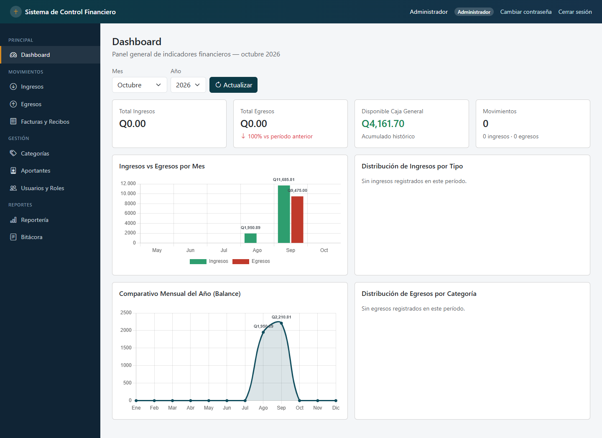
*Menú lateral completo visible para el rol Administrador (Dashboard, Movimientos, Gestión y Reportes).*

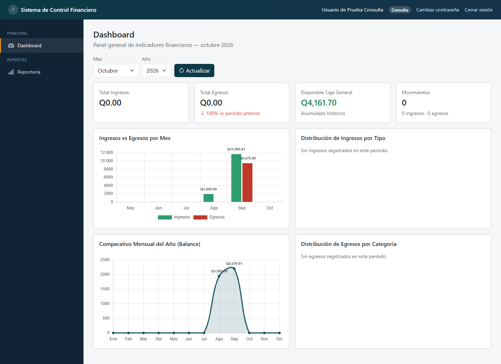
*El mismo menú con la sesión de un rol Consulta: solo ve Dashboard y Reportería.*

---

## 3. Dashboard

Pantalla de inicio tras iniciar sesión (`Dashboard` en el menú).

- **Selector de Mes y Año**: seleccione cualquier mes/año (hasta 4 años atrás). Al entrar por primera vez siempre muestra el **mes actual** por defecto.
- **Tarjetas KPI**:
  - **Total Ingresos** y **Total Egresos** del mes/año elegido, comparados contra el período anterior equivalente (↑/↓ %).
  - **Disponible Caja General**: saldo acumulado **histórico** (todos los ingresos activos menos todos los egresos activos desde siempre) — no depende del mes seleccionado, siempre refleja cuánto hay disponible en caja hoy. Se muestra en un cuadro verde independiente para no confundirlo con los totales del período.
  - **Movimientos** del período: cantidad de ingresos y egresos.
- **Gráfica "Ingresos vs Egresos por Mes"**: barras de los últimos 6 meses, con el **monto en Quetzales sobre cada barra**.
- **Gráfica "Distribución de Ingresos por Tipo"**: dona con el peso de Diezmos, Ofrendas, Donaciones y Actividades Especiales — muestra el **porcentaje sobre cada segmento** y el **monto en el centro** de la dona. El nombre (Total / Subtotal / el tipo puntual si se aísla un segmento haciendo clic en la leyenda) se muestra **arriba de la dona**, no dentro del círculo, para que nombres largos no se corten.
- **Gráfica "Comparativo Mensual del Año"**: balance (ingresos − egresos) mes a mes del año en curso, con el monto sobre cada barra; a media anchura, junto a la dona de egresos.
- **Gráfica "Distribución de Egresos por Categoría"**: dona con el peso de cada categoría de gasto (Servicios Públicos, Materiales y Suministros, etc.) del período seleccionado — misma mecánica que la dona de Ingresos (porcentaje por segmento, monto en el centro, nombre arriba de la dona). Permite ver no solo de dónde entra el dinero, sino en qué se está gastando.


*Dashboard con sus cuatro gráficas: barras de Ingresos vs Egresos, dona de Distribución de Ingresos, línea de Comparativo Mensual, y dona de Distribución de Egresos por Categoría.*

---

## 4. Categorías *(solo Administrador)*

Menú: **Gestión → Categorías**. Clasifican todos los ingresos y egresos del sistema.

- **Dos tablas separadas**: "Categorías de Ingreso" y "Categorías de Egreso", cada una ordenada alfabéticamente — nunca se mezclan en una sola tabla.
- **Filtros** (aplican a ambas tablas a la vez): buscar por nombre y estado (Activas/Inactivas).
- **+ Nueva Categoría**: nombre, tipo, descripción (opcional), estado. La columna **Movimientos** muestra cuántos ingresos o egresos ya usan esa categoría.
- No se permite un nombre duplicado dentro del mismo tipo (puede repetirse el nombre entre una categoría de ingreso y una de egreso).
- **No se pueden eliminar** — solo desactivar, para no perder el historial de los movimientos que ya las usan.

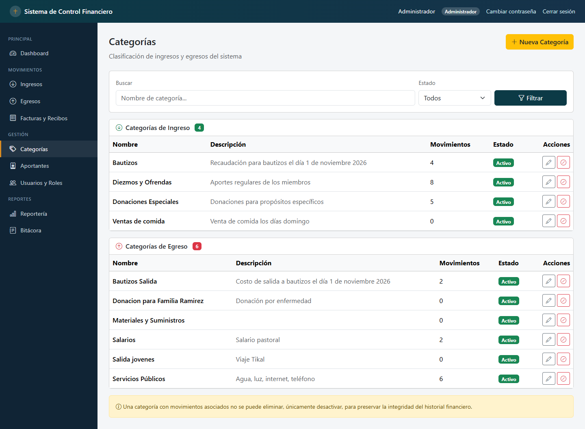
*Listado con ambas tablas: Categorías de Ingreso y Categorías de Egreso.*

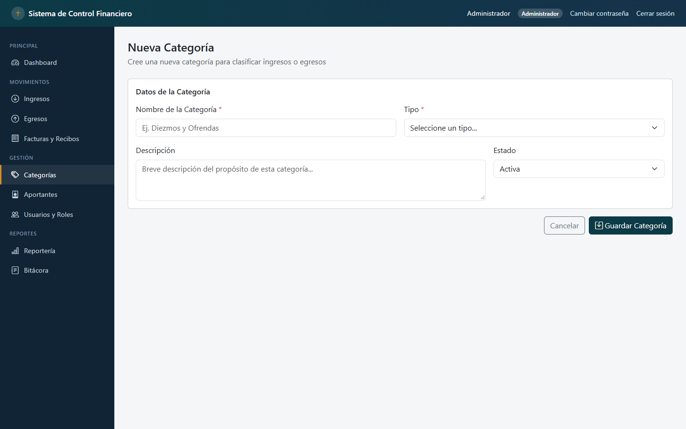
*Formulario de creación de una nueva categoría.*

---

## 5. Aportantes *(solo Administrador)*

Menú: **Gestión → Aportantes**. Son las personas identificadas en los ingresos (quién dio un diezmo, una donación, etc.).

- **Listado**: buscar por nombre, documento o correo; filtrar por estado. La columna **Ingresos** muestra cuántos ingresos tiene registrados esa persona.
- **+ Nuevo Aportante**: nombre completo (obligatorio), documento de identidad, teléfono, correo, dirección, observaciones — todos opcionales salvo el nombre.
- **Editar** y **Activar/Desactivar**, igual que en los demás catálogos.
- También se puede crear un aportante **al vuelo** desde el formulario de Ingresos (botón "+ Registrar Nuevo Aportante"), sin pasar por esta pantalla — esta vista sirve para **corregir o completar** sus datos después.

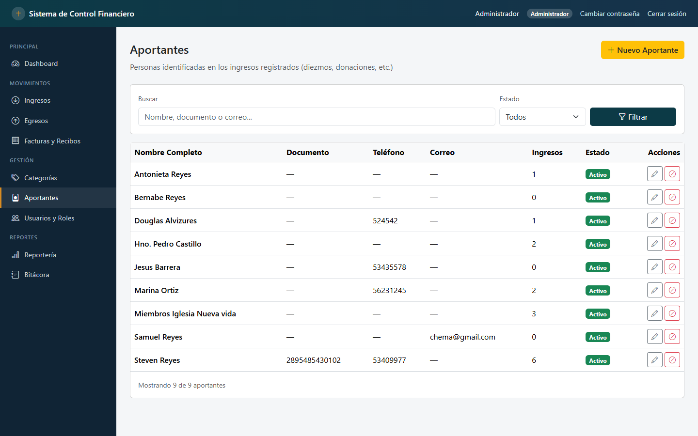
*Listado de aportantes registrados.*

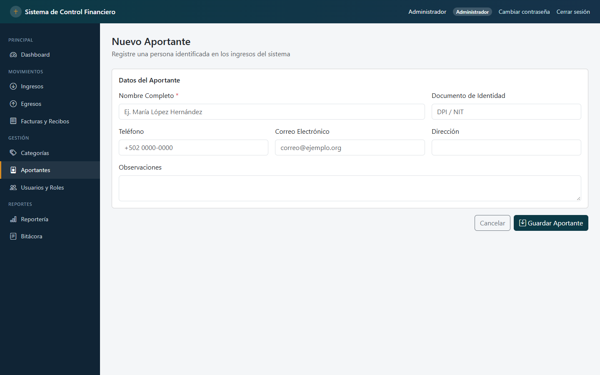
*Formulario de registro de un nuevo aportante.*

---

## 6. Usuarios y Roles *(solo Administrador)*

Menú: **Gestión → Usuarios y Roles**.

- **Listado**: buscar por nombre/usuario/correo, filtrar por rol y por estado (Activo/Inactivo), con paginación.
- **+ Nuevo Usuario**: complete nombre de usuario, nombre completo, correo, teléfono (opcional), contraseña y confirmación, rol y estado. La contraseña debe cumplir las mismas reglas de seguridad usadas en recuperación de contraseña: mínimo 8 caracteres, una mayúscula, un número y un símbolo (`!@#$%&*`).
- **Editar** (ícono de lápiz): igual que crear, pero la contraseña es opcional — si se deja en blanco, la contraseña actual no cambia. Un Administrador puede establecer la contraseña de **cualquier otro usuario, sin importar su rol**, directamente desde este formulario, sin necesidad de pasar por el correo de recuperación. Al editar **su propio usuario**, los campos de contraseña no aparecen aquí — en su lugar hay un botón "Cambiar mi contraseña" que lleva a la pantalla dedicada (la que exige confirmar la contraseña actual), para no permitir cambiarse la contraseña a sí mismo sin esa verificación.
- **Activar/Desactivar** (ícono circular): cambia el estado del usuario. No puede desactivar su propio usuario mientras tiene la sesión abierta.

### Cambiar mi propia contraseña *(todos los roles)*

Desde el ícono de llave en la barra superior ("Cambiar contraseña"), cualquier usuario logueado puede actualizar su propia contraseña sin pasar por el correo de recuperación. Debe ingresar su **contraseña actual** (se valida antes de permitir el cambio) más la nueva contraseña dos veces, cumpliendo las mismas reglas de seguridad.

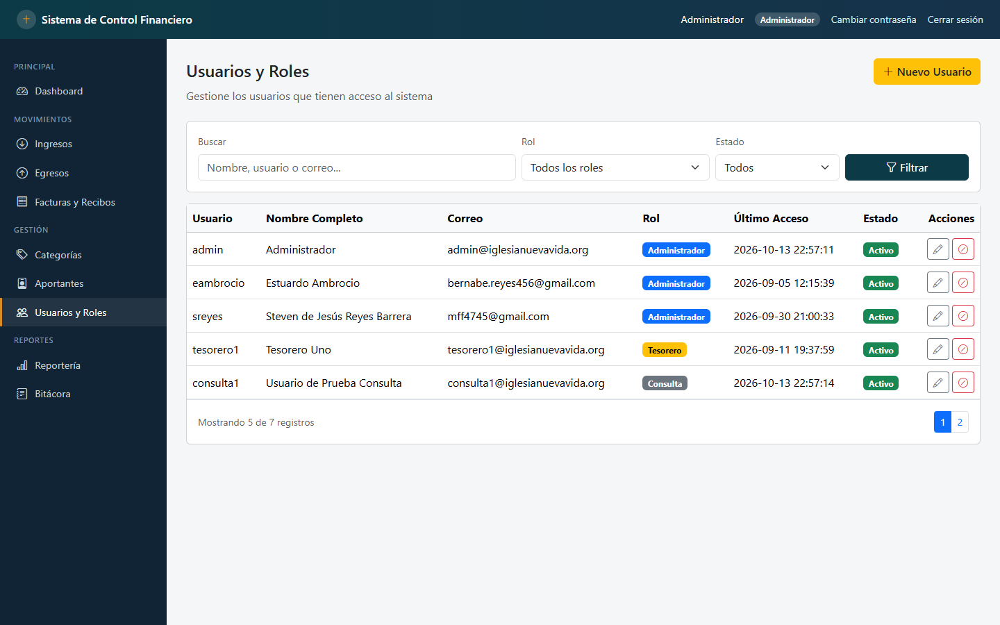
*Listado de usuarios del sistema.*

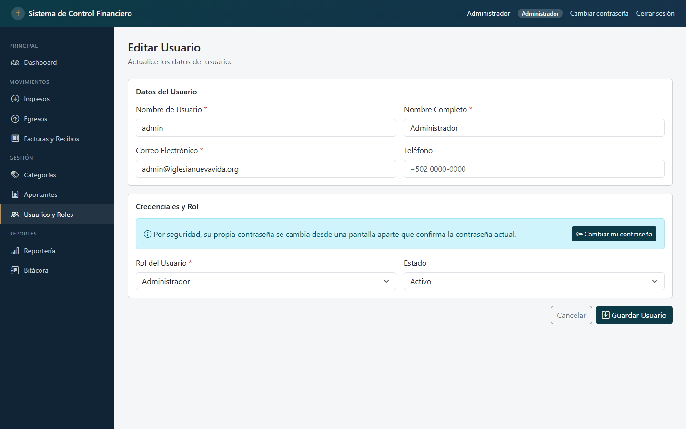
*Al editar su propio usuario, los campos de contraseña se reemplazan por el aviso y el botón "Cambiar mi contraseña".*

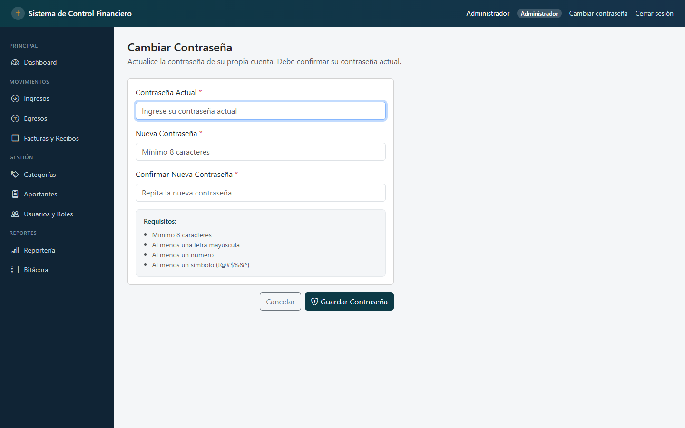
*Pantalla dedicada de autogestión de contraseña, accesible desde el ícono de llave en la barra superior.*

---

## 7. Ingresos *(Administrador y Tesorero gestionan; Supervisor solo consulta)*

Menú: **Movimientos → Ingresos**.

- **Disponible Caja General**: visible en un cuadro verde tanto en el listado como en el formulario de registro, siempre actualizado con los datos más recientes.
- **KPIs**: total del mes actual (con el nombre del mes visible, ej. "Total de Septiembre 2026"), cantidad de registros y promedio diario.
- **Filtros**: rango de fechas, categoría, tipo de ingreso. Al pie del listado, **"Total filtrado"** muestra en una píldora destacada la suma de lo que el filtro actual está mostrando (distinto del KPI "Total del mes", que no cambia con el filtro).
- **+ Nuevo Ingreso**:
  - Fecha, **Tipo de Ingreso** (Diezmo, Ofrenda, Donación Especial, Actividad Especial), Categoría, Monto, Descripción (opcional).
  - **Aportante**: opcional en general, pero **obligatorio para Diezmo y Donación Especial**. Puede elegir uno ya registrado o crear uno nuevo sin salir del formulario con el botón **"+ Registrar Nuevo Aportante"**. Solo Administrador y Tesorero llegan a esta pantalla.
  - **Comprobante**: opcional — **Tomar Foto** (abre la cámara del dispositivo) o **Elegir Archivo** (PDF/JPG/PNG hasta 5 MB), o arrastrarlo a la zona marcada. Al guardarlo, **se crea automáticamente un documento en Facturas y Recibos** vinculado a este ingreso (numerado `ING-<id>`).
- En el listado, el ícono de ojo bajo "Comprobante" abre ese documento.
- **Editar un ingreso que ya tiene un documento vinculado**: el sistema avisa antes de guardar que el documento también se actualizará (monto, fecha y aportante) con los nuevos datos, y lo hace automáticamente al confirmar.
- **Anular**: oculta el ingreso del listado y de todos los totales/KPIs, y **anula también el documento vinculado**, avisando antes con un mensaje de confirmación. El registro no se borra de la base de datos (queda para auditoría en la Bitácora).
- Todo cambio en cascada (crear/editar/anular documentos por esta vía) queda registrado en la **Bitácora**.

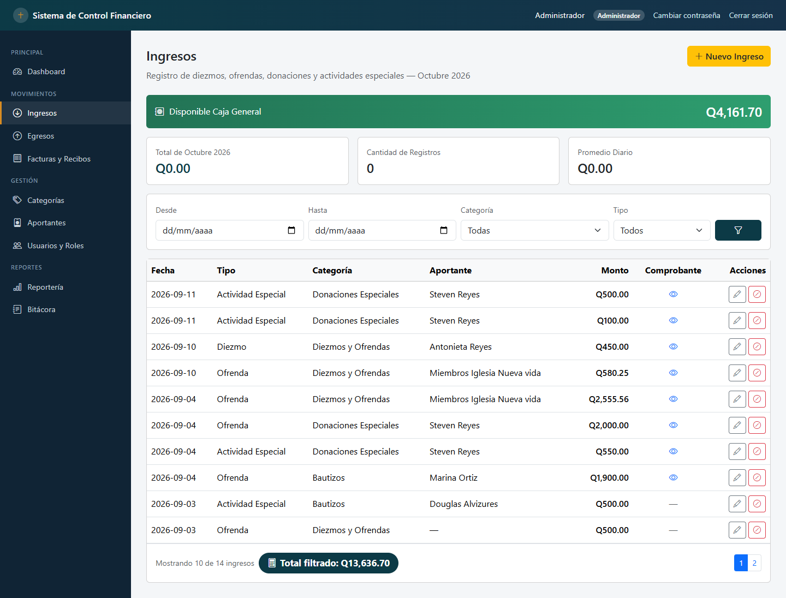
*Listado de Ingresos con el Disponible Caja General, los KPIs del mes, y la píldora "Total filtrado" al pie.*

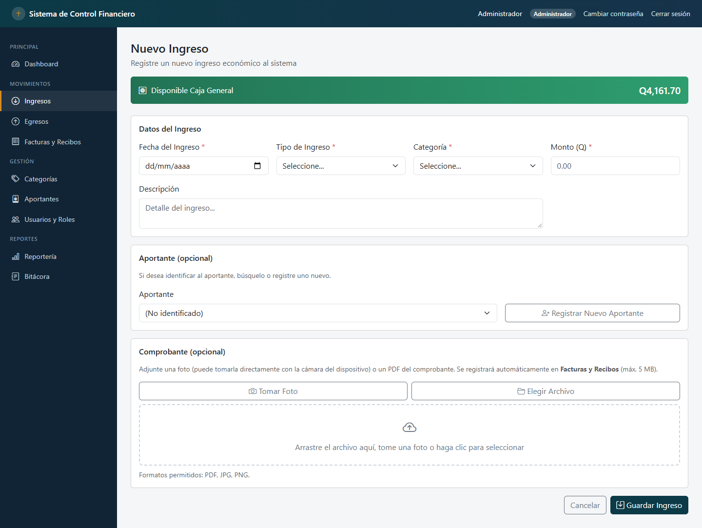
*Formulario de registro de un nuevo ingreso.*

---

## 8. Egresos *(mismo esquema de permisos que Ingresos)*

Menú: **Movimientos → Egresos**.

- **Disponible Caja General**: igual que en Ingresos, visible en el listado y en el formulario.
- **KPIs**: total del mes actual (con el nombre del mes visible), cantidad de registros y monto promedio.
- **Filtros**: rango de fechas, categoría, beneficiario. Al pie del listado, **"Total filtrado"** muestra en una píldora destacada la suma de lo que el filtro actual está mostrando.
- **+ Nuevo Egreso**: fecha, categoría, monto, **Beneficiario** (obligatorio) y **Descripción** (obligatoria), Observaciones (opcional).
  - Si el **monto** ingresado supera el **Disponible Caja General** actual, aparece una advertencia visual bajo el campo (no bloquea el registro, es solo informativa).
- **Comprobante**: igual que en Ingresos — **Tomar Foto** o **Elegir Archivo** (PDF/JPG/PNG hasta 5 MB); al guardarlo se crea automáticamente el documento en Facturas y Recibos (numerado `EGR-<id>`).
- **Vincular Factura (opcional)**: alternativa manual — elija una factura ya registrada, o cree una nueva con el botón **"+ Registrar Nueva Factura"** sin salir del formulario. Si sube un comprobante directamente, ese siempre tiene prioridad sobre esta selección.
- **Editar/Anular** con documento vinculado: mismo comportamiento en cascada que en Ingresos (avisa, actualiza o anula el documento vinculado, y lo registra en Bitácora).

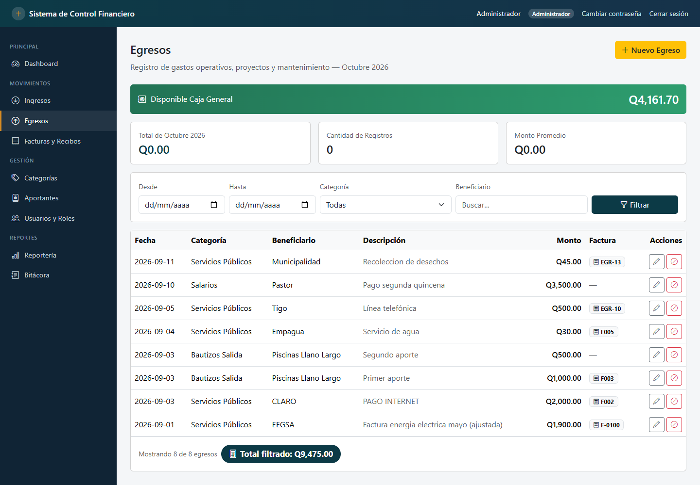
*Listado de Egresos.*

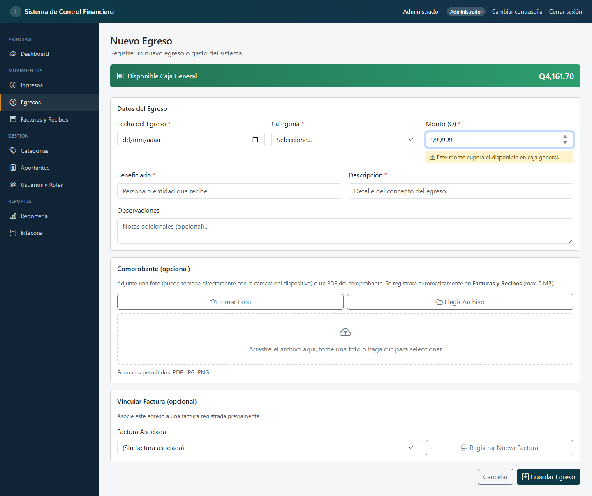
*Formulario "Nuevo Egreso": al ingresar un monto superior al Disponible Caja General, aparece la advertencia visual bajo el campo.*

---

## 9. Facturas y Recibos *(mismo esquema de permisos)*

Menú: **Movimientos → Facturas y Recibos**. Aquí se ven **todos** los documentos del sistema, generados automáticamente desde Ingresos/Egresos o registrados manualmente aquí — Factura, Recibo o Nota de Crédito.

- **Filtros**: buscar por número de documento o beneficiario, tipo de documento, rango de fechas de emisión, y **"Vinculado a"** (Ingresos / Egresos / Sin vincular) para ver de un vistazo el origen de cada documento.
- **+ Nueva Factura**: número de documento, tipo, fecha de emisión, monto, **Beneficiario / Aportante**, descripción (opcional).
- **Archivo del documento**: **obligatorio al crear** (PDF/JPG/PNG hasta 5 MB). Al editar es opcional — si no se sube uno nuevo, se conserva el archivo original.
- **Vincular a un Movimiento (opcional)**: asocie el documento a un **Egreso** o a un **Ingreso** ya existente. La columna "Vinculado a" del listado muestra a cuál pertenece.
- **Editar un documento vinculado**: el sistema avisa antes de guardar que el ingreso/egreso asociado también se actualizará (monto, fecha, beneficiario), y lo hace automáticamente al confirmar.
- **Anular**: si el documento está vinculado, también anula el ingreso/egreso asociado (con aviso previo). El registro no se borra de la base de datos.

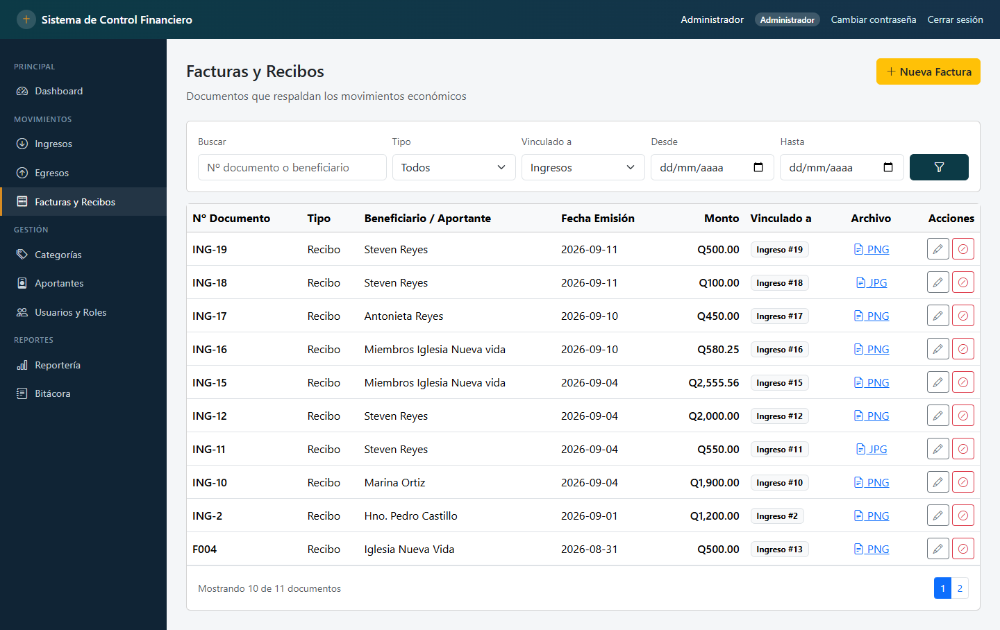
*Listado con el filtro "Vinculado a: Ingresos" aplicado.*

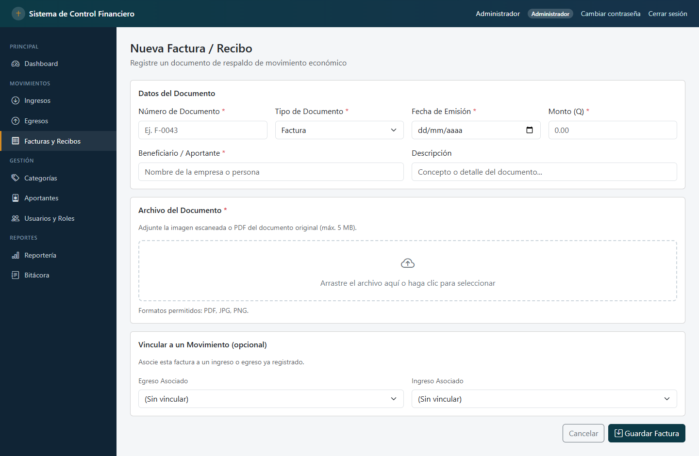
*Formulario de registro manual de una factura o recibo.*

---

## 10. Reportería *(todos los roles, incluido Consulta)*

Menú: **Reportes → Reportería**.

1. Elija **Tipo de Reporte**:
   - **Reporte de Ingresos** o **Reporte de Egresos** (con filtro opcional de Categoría).
   - **Reporte Consolidado (Ingresos y Egresos)**: muestra ambos movimientos juntos en una sola tabla ordenada por fecha, con Total Ingresos, Total Egresos y Balance del período.
2. Complete el rango de fechas (**Desde/Hasta**, obligatorios) y presione **Generar** para ver la vista previa con sus KPIs y la tabla detallada.
3. **Exportar Excel**: descarga un archivo `.xlsx` real con estilo profesional (colores institucionales, encabezados resaltados, montos con formato de moneda, totales destacados) — no un CSV.
4. **Exportar PDF**: descarga directamente un PDF con el mismo estilo institucional (no abre ninguna ventana de impresión).
5. Cada vez que se presiona **Generar** (no solo al exportar), la consulta queda registrada en la Bitácora, ya que desde ahí se puede ver información financiera sensible.

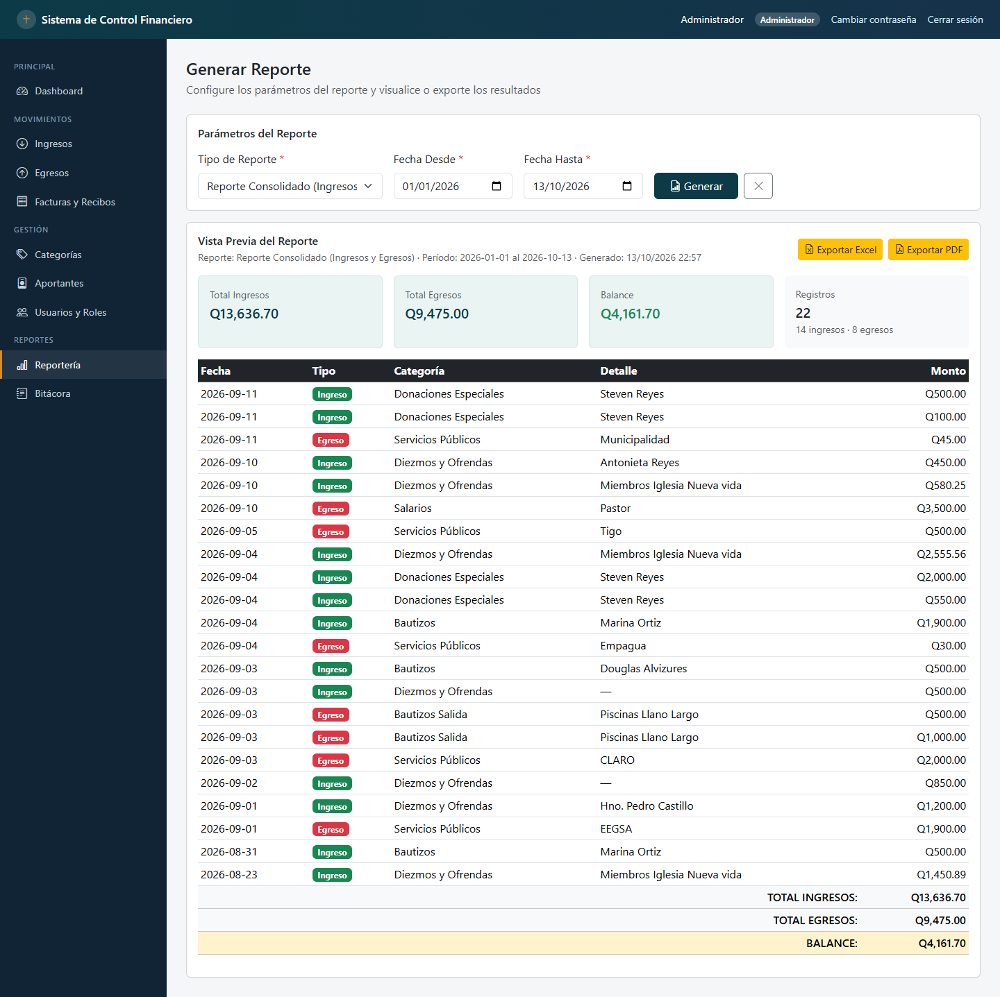
*Vista previa de un Reporte Consolidado, con sus KPIs (Total Ingresos, Total Egresos, Balance, Registros) y la tabla detallada.*

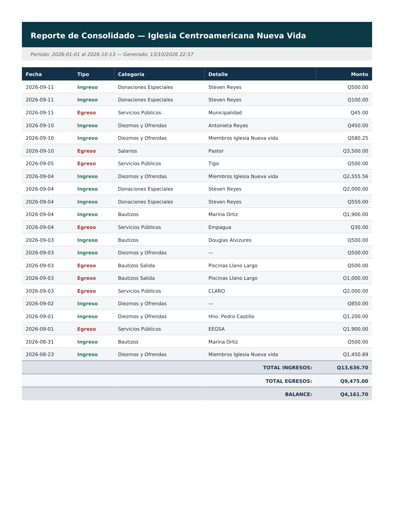
*El mismo reporte exportado a PDF, con el estilo institucional (encabezado navy/teal, totales destacados).*

---

## 11. Bitácora *(Administrador y Supervisor)*

Menú: **Reportes → Bitácora**. Registro de auditoría de todo lo que ocurre en el sistema.

- Registra automáticamente: inicios de sesión (exitosos y fallidos), creación/modificación/anulación en todos los módulos (incluyendo los cambios en cascada entre movimientos y documentos vinculados), cada consulta generada en Reportería, y cada exportación.
- **Es de solo lectura**: ningún evento puede modificarse ni eliminarse, para garantizar la integridad de la auditoría.
- La columna **Descripción** muestra cada dato en su propia línea (tipo, monto, involucrados) en vez de una sola oración separada por guiones, para que sea más fácil de leer.
- **Filtros**: rango de fecha, usuario, módulo, acción. El filtro de fecha incluye el día completo (de 00:00:00 a 23:59:59), así que buscar con la fecha de hoy sí muestra los eventos de hoy.
- **Exportar Bitácora**: descarga un **PDF** con estilo institucional (ya no exporta a Excel, y ya no muestra la columna IP Origen ni en pantalla ni en la exportación).

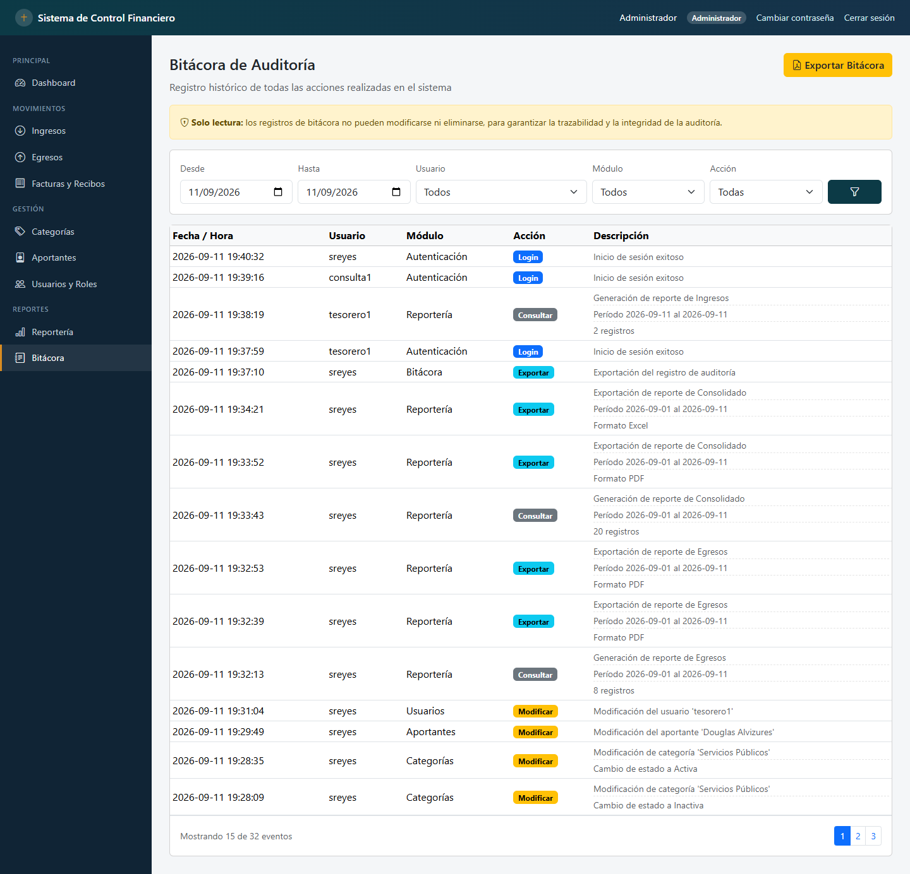
*Bitácora filtrada por un día específico, mostrando distintos tipos de eventos (Login, Login fallido, Consultar, Exportar, Modificar) y la columna Descripción con varias líneas por evento.*

---

## Anexo: Notas técnicas para quien administre el sistema

- Los comprobantes y documentos (Ingresos, Egresos y Facturas) se guardan en `storage/facturas/`, y los comprobantes antiguos previos a este cambio siguen disponibles en `storage/adjuntos/` — ambas carpetas **fuera del acceso público** (protegidas con `.htaccess`); solo se pueden ver a través del sistema, con sesión iniciada y permiso sobre el módulo correspondiente.
- El proyecto ahora usa **Composer** (`composer.json` / `composer.lock` / carpeta `vendor/`, también protegida por `.htaccess`) para dos librerías: `phpoffice/phpspreadsheet` (Excel) y `dompdf/dompdf` (PDF). Si se copia el proyecto a otra máquina, hay que correr `composer install` una vez. Esto requirió habilitar las extensiones de PHP `gd` y `zip` en `C:\xampp\php\php.ini` (ya están activadas en este equipo).
- **Zona horaria**: `php.ini` traía `Europe/Berlin` de fábrica; se corrigió a `America/Guatemala` para que las horas mostradas en el sistema (ej. "Generado:" en los reportes) coincidan con la hora real.
- **Diseño responsivo**: el menú lateral se oculta en pantallas de celular y se abre con el botón de hamburguesa (☰) junto al logo. Si algo se ve apretado en un equipo específico, revisar primero el zoom del navegador.
- Los archivos `tmp_create_admin.php` y `tmp_create_test_users.php` son herramientas de un solo uso para crear los usuarios iniciales. Pueden borrarse cuando ya no se necesiten.
- **Pendiente**: una decisión sobre cómo registrar traslados internos entre caja y banco (el esquema actual no tiene concepto de "cuentas"). No queda ningún módulo o pantalla sin construir. (Se evaluó una pantalla de Configuración del sistema, pero se decidió que no era necesaria para el alcance del proyecto y se descartó — incluida la tabla `configuracion`, que se eliminó de la base de datos.)
- **Cambios de esquema de base de datos**: se agregó la columna `id_factura` (nullable) a la tabla `ingresos`, para que los ingresos también puedan vincularse a un documento igual que los egresos (cambio aditivo, no afecta datos existentes). Por otro lado, se **eliminó la tabla** `configuracion` (existía vacía desde el script SQL original; se llegó a construir una pantalla de parámetros generales sobre ella, pero se decidió que no era necesaria y se revirtió por completo). El esquema pasó de 13 a 12 tablas.
